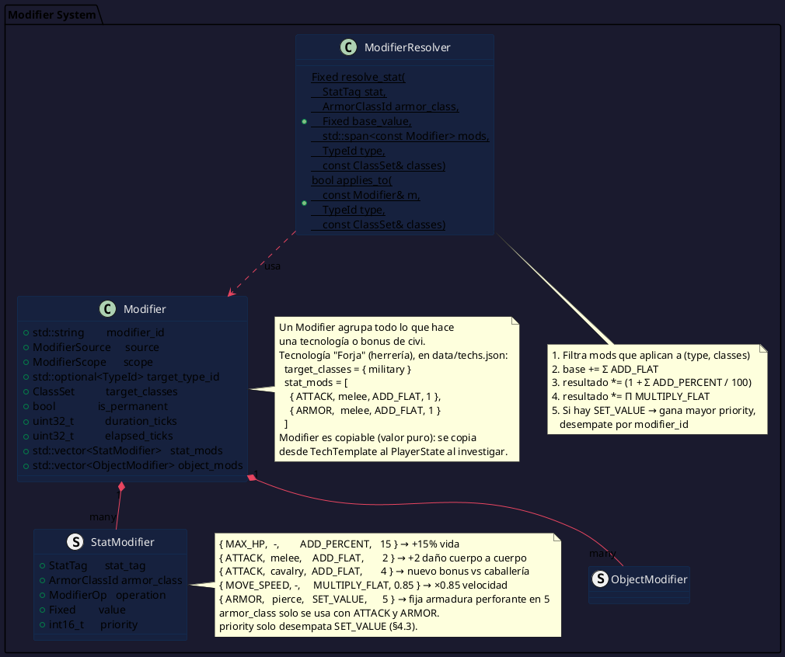
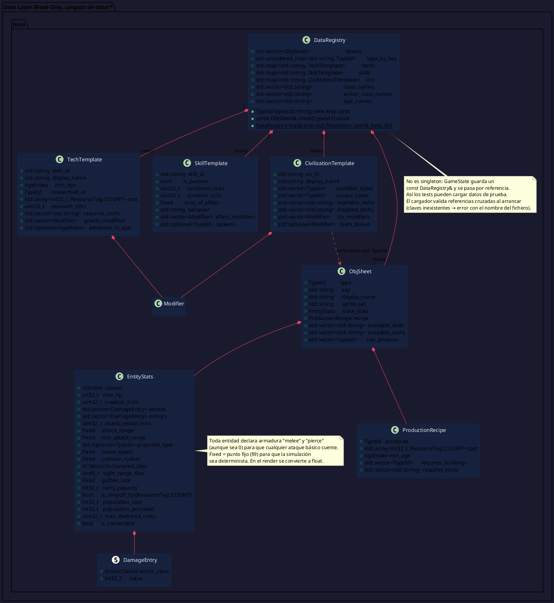
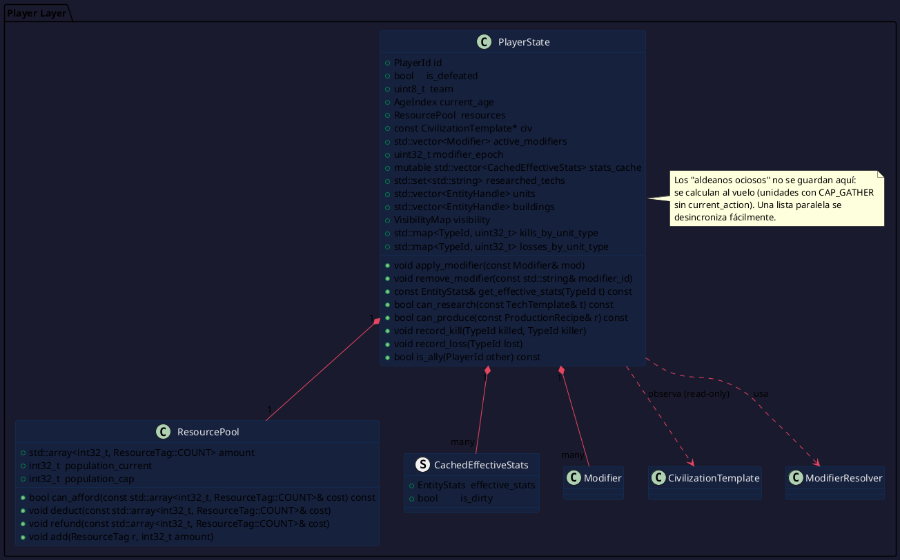
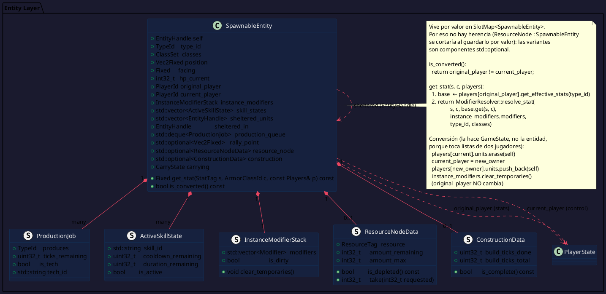
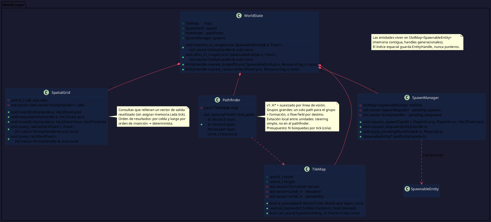
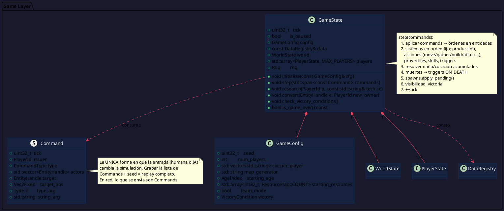
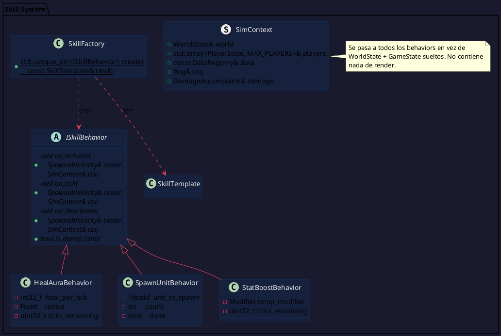
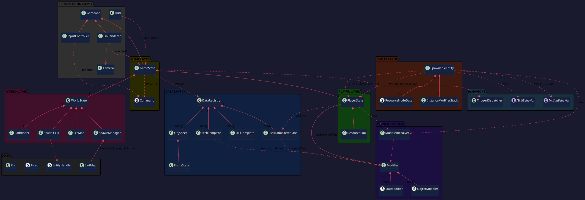

# Arquitectura de Clases — RTS histórico (C++20 / SFML 3)
> **v3** — Corrige la v2 tras la revisión de noviembre de 2026. Diagramas PlantUML renderizables en [PlantUML Online](https://www.plantuml.com/plantuml/uml/).
> Complementos: [`mutability.md`](mutability.md) (capabilities, acciones y triggers) · [`ROADMAP.md`](ROADMAP.md) (orden de implementación) · [`README.md`](README.md) (cómo compilar).

### Cambios respecto a la v2

| # | v2 | v3 | Por qué |
|---|---|---|---|
| 1 | Identidad = puntero (`SpawnableEntity*`), sin IDs | **`EntityHandle` generacional** (índice + generación) en un `SlotMap` | Los punteros guardados (objetivo de ataque, unidades guarecidas, aldeanos ociosos) quedan colgando cuando la entidad muere, y una dirección reciclada apunta a *otra* entidad. Además no se pueden serializar (guardar partida, replays, órdenes por red). |
| 2 | `PlayerState*` dentro de cada entidad | **`PlayerId`** (`uint8_t`) | `std::vector<PlayerState>` invalida punteros si se redimensiona; un índice no. |
| 3 | `enum ObjTag { VILLAGER, KNIGHT, ... }`, `enum AgeTag { DARK_AGE, ... }` | **`TypeId`, `ClassSet`, `AgeIndex` definidos por datos** | El README promete "cambiar cualquier variable es editar datos". Un enum de unidades obliga a recompilar para añadir una. Los enums quedan solo para lo que el motor implementa en código (stats, operaciones de modificador, capabilities, eventos). |
| 4 | Un solo `ClassTag` por entidad | **Conjunto de clases** (`ClassSet`, bitset) | Un caballero es a la vez `cavalry` y `military`. `mutability.md` ya filtraba por clases que el enum no tenía (`SIEGE_WEAPON`, infantería). |
| 5 | `ArmorTag` único + `AttackBonus` sueltos | **Ataques y armaduras por clase de armadura** (§4.5) | Un único modelo cubre cuerpo a cuerpo, perforante, bonus contra caballería, contra edificios, etc. |
| 6 | QuadTree | **Rejilla uniforme alineada a los tiles** | Las unidades se mueven cada tick; reinsertar en un QuadTree es caro. El mapa ya es una rejilla. |
| 7 | `dt` variable, `float` en todo | **Tick fijo + simulación determinista** (§9) | Requisito para replays, depuración reproducible y multijugador lockstep. |
| 8 | Sin capa de render/entrada definida | **§10 Render con SFML** y **§11 sistemas que faltaban** | Niebla de guerra, selección, colocación de edificios, IA, etc. no aparecían. |
| 9 | Ejemplos con civilizaciones, unidades y tecnologías de un juego comercial concreto | **Ejemplos genéricos** (civ A, civ B, "Jinete de Jade") | El motor no conoce contenido; el contenido real vive en `data/` y debe ser propio. |

---

## 1. Visión General del Sistema

El juego se divide en **dos mitades** que no se mezclan:

- **Simulación** (`sim/`): estado autoritativo, avanza en ticks fijos, no conoce SFML (salvo tipos matemáticos triviales, que conviene aislar en `core/`). Se puede ejecutar sin ventana (tests, IA, servidor).
- **Presentación** (`render/`, `input/`, `app/`): lee el estado de la simulación para dibujarlo y traduce la entrada del jugador en **comandos**. Nunca modifica la simulación directamente.

```
┌──────────────────────────────────────────────────────────┐
│  PRESENTACIÓN                                            │
│  render (SFML: mapa iso, sprites, HUD, minimapa)         │
│  input  (selección, atajos → Command)                    │
├──────────────── Command queue (por tick) ────────────────┤
│  SIMULACIÓN                                              │
│  4. GAME       (GameState, tick fijo, victoria, triggers)│
│  3. WORLD      (TileMap, SpatialGrid, pathfinding,       │
│                 visibilidad, SlotMap de entidades)       │
│  2. PLAYER     (recursos, tecnologías, modificadores)    │
│  1. DATA       (plantillas cargadas de data/*.json)      │
├──────────────────────────────────────────────────────────┤
│  CORE          (EntityHandle, SlotMap, Fixed, Rng, Id)   │
└──────────────────────────────────────────────────────────┘
```

Cada capa solo conoce las inferiores. La separación fundamental se mantiene:
- **WorldState** → sabe *dónde* están las cosas (posición, colisión, pathfinding, visibilidad).
- **PlayerState** → sabe *qué tan poderosas* son las cosas (stats, modificadores, recursos). Vive **toda la partida**.
- **SpawnableEntity** → instancia viva que une ambos mundos. Se referencia **por `EntityHandle`**, nunca por puntero guardado.

---

## 2. Identidad de Entidades: Handles Generacionales

> La v2 eliminaba `ObjId` con el argumento de que en un RTS las búsquedas son espaciales. Las *búsquedas* sí lo son, pero el problema real no es buscar: es **guardar referencias** a otras entidades que pueden morir.

Referencias guardadas que existen en todo RTS:
- el objetivo de un ataque, de una conversión o de una curación;
- el recurso que recolecta un aldeano y el edificio donde lo deposita;
- las unidades guarecidas en una torre;
- la selección del jugador y los grupos de control (Ctrl+1..9);
- las órdenes que viajan por red o se graban en un replay.

Con punteros, cuando la entidad muere el puntero queda colgando; si el pool reutiliza esa memoria, el arquero sigue disparando a **otra** unidad (problema ABA). Además, iterar un `std::unordered_set<T*>` da un orden que depende de las direcciones de memoria: dos máquinas simulan distinto.

### 2.1 La solución

```cpp
struct EntityHandle {
    uint32_t index      = UINT32_MAX;  // hueco en el SlotMap
    uint32_t generation = 0;           // se incrementa cada vez que el hueco se reutiliza
    bool operator==(const EntityHandle&) const = default;
    explicit operator bool() const { return index != UINT32_MAX; }
};

template <class T>
class SlotMap {
public:
    EntityHandle insert(T value);
    void         erase(EntityHandle h);            // ++generation del hueco, lo añade a la free list
    T*           get(EntityHandle h);              // nullptr si h.generation no coincide → la entidad murió
    const T*     get(EntityHandle h) const;
    // Iteración en orden de índice → determinista
    template <class F> void for_each(F&& f);
private:
    std::vector<T>        slots;        // almacenamiento contiguo (cache-friendly)
    std::vector<uint32_t> generations;
    std::vector<uint8_t>  alive;
    std::vector<uint32_t> free_list;
};
```

Reglas:
- **Guardar** = `EntityHandle`. **Usar dentro de un tick** = `SpawnableEntity&` obtenido con `world.entities.get(h)`; nunca se guarda esa referencia.
- `get()` devolviendo `nullptr` es la forma normal de enterarse de que el objetivo murió: la acción se cancela o busca otro.
- Las colecciones de la simulación que se iteran (unidades de un jugador, selección) son `std::vector<EntityHandle>` ordenados o se recorren vía `SlotMap::for_each`, nunca `unordered_set`.
- Crear y destruir entidades **durante** un tick se encola (`SpawnManager::request_spawn/request_despawn`) y se aplica al final del tick, para no invalidar iteraciones en curso (§9).

---

## 3. El Sistema de Conversión: Dual-Owner

### 3.1 El Problema

Cuando un Monje del jugador B convierte un Jinete de Jade (unidad única de la civ A), ¿qué stats tiene esa unidad?

**Decisión de diseño**: la unidad convertida **conserva los stats de su creador original**. Un Jinete de Jade trabajando para B sigue siendo tan fuerte como lo hizo la civ A. Evita romper el balance de unidades únicas. (Es una decisión propia; otros RTS hacen que la unidad adopte las mejoras del nuevo dueño. Cambiarla es tocar una línea de `get_stat`.)

### 3.2 La Solución: Dos Dueños

```cpp
// En SpawnableEntity:
PlayerId original_player;   // El que creó la unidad. NUNCA cambia.
PlayerId current_player;    // El dueño actual. Cambia en conversión.
```

| Situación | `original_player` | `current_player` | Stats vienen de |
|---|---|---|---|
| Unidad no convertida | `A` | `A` | `A` (son el mismo) |
| Unidad convertida | `A` | `B` | `A` (el original) |

La regla: **los stats de una entidad siempre se resuelven contra `original_player`**. El `current_player` determina allegiance (quién la controla, a quién aporta población, quién recibe lo que recolecta, quién la ve en su niebla de guerra).

### 3.3 Por Qué los PlayerStates Viven Toda la Partida

Si el jugador A es eliminado pero B tiene unidades convertidas de A, esas unidades siguen necesitando los modificadores de A. Por eso los `PlayerState` se destruyen solo al cerrar la partida. `GameState::players` es un `std::array<PlayerState, MAX_PLAYERS>` (o un `vector` reservado una vez) indexado por `PlayerId`.

```cpp
// Siempre seguro durante la partida:
float atk = entity.get_stat(StatTag::ATTACK_DMG, game.players);
// Internamente: players[entity.original_player].get_effective_stats(entity.type_id)
// Aunque A esté derrotado, su PlayerState sigue ahí con is_defeated = true
```

### 3.4 El Kill Counter

Cada `PlayerState` registra cuántas unidades de cada tipo han matado **sus** unidades y cuántas ha perdido.

```cpp
// En PlayerState (std::map: orden determinista para estadísticas y replays)
std::map<TypeId, uint32_t> kills_by_unit_type;   // kills_by_unit_type[jade_raider] = 12
std::map<TypeId, uint32_t> losses_by_unit_type;
```

**Decisión** (era la pregunta abierta 1 de la v2): el kill se atribuye al **`current_player`** del atacante, que es quien dio la orden; la baja, al `current_player` de la víctima. El `original_player` solo afecta a los stats.

---

## 4. El Sistema de Modificadores

### 4.1 Por Qué NO mutar `EntityStats` directamente

Mutar el stat base hace imposible deshacerlo (necesario para efectos temporales, conversión, etc.) y pierdes la procedencia del cambio.

### 4.2 Base + Lista de Modificadores → Stat Efectivo

```
stat_efectivo = f(stat_base, [mod1, mod2, mod3, ...])
```

El `ModifierResolver` es una **función pura**: recibe el valor base + lista de mods → devuelve el valor final. Nunca muta nada.

### 4.3 Orden de Aplicación (CRÍTICO)

```
1. base + Σ(ADD_FLAT)
2. paso_1 × (1 + Σ(ADD_PERCENT) / 100)
3. paso_2 × Π(MULTIPLY_FLAT)
4. Si hay SET_VALUE → reemplaza todo. Si hay varios, gana el de mayor `priority`;
   a igual prioridad, el de mayor `modifier_id` (orden total, nunca "el último aplicado").
```

Sumas y productos son conmutativos, así que el orden en que se investiguen las tecnologías no cambia el resultado. El desempate de `SET_VALUE` también es independiente del orden.

### 4.4 Lookup de Stats en una Entidad Convertida

```
entity.get_stat(ATTACK_DMG)
    │
    └─→ players[entity.original_player].get_effective_stats(entity.type_id)   // cacheado
              │
              └─→ ModifierResolver::resolve(base_stat, player.active_modifiers, type_id, class_set)
```

Los mods de instancia (efectos temporales sobre esta unidad) se aplican encima:

```
stat_final = resolve(resolve(base, player_mods), instance_mods)
```

> `get_effective_stats` es lógicamente `const` pero rellena una caché: la caché se declara `mutable`, o el método deja de ser `const`. Al aplicar un modificador de jugador se invalida la caché de los tipos afectados **y** se incrementa `player.modifier_epoch`; cada entidad guarda la época con la que reconstruyó sus capabilities y se reconstruye cuando difiere (ver `mutability.md`).

### 4.5 Daño y Armaduras por Clase

Un único modelo sustituye a `ArmorTag` + `AttackBonus`:

```cpp
// Clases de armadura definidas en datos: "melee", "pierce", "cavalry", "building", "ship", ...
using ArmorClassId = uint8_t;

struct DamageEntry { ArmorClassId armor_class; int32_t value; };

// En EntityStats:
std::vector<DamageEntry> attacks;   // p. ej. espadachín: {melee: 9}, {building: 3}
std::vector<DamageEntry> armors;    // p. ej. caballero:  {melee: 2}, {pierce: 2}, {cavalry: 0}

// Daño de A sobre B:
//   suma, para cada clase presente en A.attacks Y en B.armors, de max(0, ataque - armadura)
//   mínimo 1
int32_t compute_damage(const EntityStats& atk, const EntityStats& def);
```

- Un bonus "contra caballería" es simplemente un `DamageEntry{cavalry, +N}` en el atacante: solo cuenta si el defensor tiene la clase de armadura `cavalry`.
- Las tecnologías modifican entradas concretas (`StatModifier` con `stat_tag = ATTACK` / `ARMOR` y `armor_class`).
- Si el defensor no tiene una clase de armadura, el ataque de esa clase **no** cuenta (así un bonus contra edificios no afecta a la infantería).

---

## 5. Diagramas PlantUML

### Diagrama 1: Identificadores, Enumeraciones y Tags (Core + Data Layer)

> Regla: **enum** si el motor tiene código específico para ese valor (un stat, una operación, una capability). **Id cargado de datos** si es contenido (unidades, edificios, clases, edades, tecnologías, civilizaciones).

```plantuml
@startuml DataLayer
skinparam backgroundColor #1a1a2e
skinparam classBackgroundColor #16213e
skinparam classBorderColor #0f3460
skinparam classArrowColor #e94560
skinparam classFontColor #eaeaea

package "Ids definidos por datos (data/*.json)" {

  struct TypeId {
    + uint16_t value
  }
  note right of TypeId
    Índice en DataRegistry::sheets.
    Se obtiene una vez al cargar:
      registry.type("villager")  → TypeId
      registry.type("jade_raider") → TypeId
    El código del motor NUNCA nombra una unidad concreta.
  end note

  struct ClassSet {
    + std::bitset<64> bits
    + bool has(ClassId c) const
    + bool intersects(const ClassSet& o) const
  }
  note right of ClassSet
    Clases definidas en data/classes.json:
      "building", "military", "villager",
      "infantry", "cavalry", "archer",
      "siege", "ship", "resource_node", ...
    Una entidad pertenece a VARIAS a la vez.
  end note

  struct ArmorClassId {
    + uint8_t value
  }
  note right of ArmorClassId
    data/armor_classes.json:
      "melee", "pierce", "cavalry",
      "building", "siege", "ship", ...
  end note

  struct AgeIndex {
    + uint8_t value
  }
  note right of AgeIndex
    0..N-1 según data/ages.json.
    Nombres y número de edades son contenido.
  end note

  struct PlayerId {
    + uint8_t value
  }
}

package "Enums del motor (código)" {

  enum StatTag {
    MAX_HP
    ATTACK
    ARMOR
    ATTACK_RATE
    ATTACK_RANGE
    MOVE_SPEED
    SIGHT_RANGE
    CREATION_TIME
    CARRY_CAPACITY
    GATHER_RATE
    HEAL_RATE
    CONVERSION_RATE
    POPULATION_COST
  }
  note right of StatTag
    ATTACK y ARMOR se indexan además
    por ArmorClassId (ver §4.5).
  end note

  enum ResourceTag {
    FOOD
    WOOD
    GOLD
    STONE
    COUNT
  }
  note right of ResourceTag
    Fijo en el motor por simplicidad:
    los costes son std::array<int32_t, COUNT>.
  end note

  enum ModifierOp {
    ADD_FLAT
    ADD_PERCENT
    MULTIPLY_FLAT
    SET_VALUE
  }
  note right of ModifierOp
    Otorgar/quitar capabilities, triggers
    y skills NO es un ModifierOp: lo hace
    ObjectModifier (mutability.md).
  end note

  enum ModifierSource {
    CIVILIZATION_BONUS
    TECHNOLOGY
    AGE_UP
    PASSIVE_SKILL
    ACTIVE_SKILL
    RELIC
    GARRISONED
    WONDER
  }

  enum ModifierScope {
    PLAYER_WIDE
    UNIT_INSTANCE
    BUILDING_INSTANCE
    TEAM_WIDE
  }
}
@enduml
```



---

### Diagrama 2: Sistema de Modificadores



---

### Diagrama 3: Data Layer — Plantillas Estáticas



---

### Diagrama 4: Player State



---

### Diagrama 5: Entidades en el Mundo



---

### Diagrama 6: World State (rejilla de tiles + índice espacial uniforme)



---

### Diagrama 7: GameState — Orquestador



---

### Diagrama 8: Sistema de Habilidades (Strategy Pattern)

> En la v2 la conversión y los proyectiles eran *skills*. Se mueven: la conversión es una **acción ordenada** (`ConvertActionBehavior` en `mutability.md`) y los proyectiles son **entidades** (§11.3). Aquí quedan solo las habilidades con cooldown que se activan.



---

### Diagrama 9: Vista Completa de Capas



---

## 6. Flujos Clave

### 6.1 Conversión de una Unidad (Monje)

```
ConvertActionBehavior::on_tick(monje_B)   // completa la conversión
    │
    ├── target = jinete_jade_A (original_player = A, current_player = A)
    ├── Llama GameState::convert(target_handle, monje.current_player = B)
    │       ├── players[A].units.erase(target)
    │       ├── target.current_player = B
    │       ├── players[B].units.push_back(target)
    │       ├── target.instance_modifiers.clear_temporaries()
    │       ├── cancela la acción en curso del target
    │       └── original_player sigue siendo A
    │
    └── Resultado: el jinete pertenece a B
        PERO sus stats siguen calculándose con los mods de A
        → Si A tenía "Filo de Obsidiana" (+4 ataque), el jinete convertido
          aún tiene ese bonus aunque B no haya investigado esa tech.
```

### 6.2 Muerte de una Unidad y Kill Counter

```
AttackActionBehavior::on_tick(espada_B)          // en el tick del recarga
    │
    ├── target = world.spawns.get(target_handle)
    │       └── nullptr → el objetivo ya murió: buscar otro o terminar
    ├── dmg = compute_damage(espada.stats_efectivos, arquero.stats_efectivos)   // §4.5
    └── ctx.damage.add(target_handle, dmg, attacker = espada_handle)
                                                   // se acumula, no se aplica aún

GameState::step — fase "resolver daño"
    │
    ├── arquero.hp_current -= daño_acumulado
    └── Si arquero.hp_current <= 0:
            TriggerDispatcher::dispatch(ON_DEATH, arquero, killer = espada)
            players[espada.current_player].record_kill(arquero.type_id, espada.type_id)
            players[arquero.current_player].record_loss(arquero.type_id)
            world.spawns.request_despawn(arquero_handle)   // se aplica al final del tick
```

> Acumular el daño y aplicarlo en una fase propia hace que el resultado no dependa del orden en que se procesan las unidades: dos unidades que se matan mutuamente en el mismo tick mueren las dos. (El prototipo en Python ya hacía esto con `_pending_damage`.)

### 6.3 Investigar una Tecnología

```
Command{ RESEARCH, issuer = B, actors = [herreria], string_arg = "forja" }
    │
    ├── tech = data.techs["forja"]
    ├── players[B].can_research(tech) → OK
    ├── players[B].resources.deduct(tech.cost)
    └── herreria.production_queue.push_back({ is_tech = true, "forja", tech.research_ticks })

... N ticks después, ProductionSystem termina el job:
GameState::research(B, "forja")
    ├── for mod in tech.grants_modifiers: players[B].apply_modifier(mod)
    │       ├── active_modifiers.push_back(mod)
    │       ├── stats_cache[t].is_dirty = true  para cada TypeId afectado
    │       └── ++modifier_epoch
    └── players[B].researched_techs.insert("forja")

Próximo uso: milicia_B.get_stat(ATTACK, melee)
    → resolve(base = 4, players[B].active_modifiers) = 4 + 1 = 5
    (Una milicia de A convertida por B NO se beneficia: usa players[A].active_modifiers)
```

### 6.4 Subir de Edad

Subir de edad es **una tecnología más** con `advances_to_age` (así hereda coste, tiempo de investigación, cola y requisitos sin código especial):

```
GameState::research(B, "age_2")
    ├── aplica tech.grants_modifiers (bonus de edad, si los hay)
    ├── players[B].current_age = *tech.advances_to_age
    ├── TriggerDispatcher::dispatch(ON_AGE_UP) a las entidades de B
    └── la UI vuelve a calcular qué recetas/techs están disponibles (min_age)
```

---

## 7. Estructura de Archivos

```
aoe-clone/
├── CMakeLists.txt
├── CMakePresets.json
├── data/                       ← contenido del juego (JSON); el motor no lo conoce
│   ├── classes.json            ← clases de entidad y de armadura
│   ├── ages.json
│   ├── units/*.json
│   ├── buildings/*.json
│   ├── resources/*.json
│   ├── techs/*.json
│   ├── skills/*.json
│   ├── triggers/*.json
│   └── civs/*.json
├── assets/                     ← sprites, tilesets, sonidos, fuentes (propios o con licencia libre)
├── src/
│   ├── core/
│   │   ├── entity_handle.hpp
│   │   ├── slot_map.hpp
│   │   ├── fixed.hpp           ← punto fijo 16.16 o 32.32
│   │   ├── vec2_fixed.hpp
│   │   └── rng.hpp             ← PCG/xorshift con semilla
│   ├── data/
│   │   ├── ids.hpp             ← TypeId, ClassSet, ArmorClassId, AgeIndex, PlayerId
│   │   ├── entity_stats.hpp
│   │   ├── obj_sheet.hpp
│   │   ├── tech_template.hpp
│   │   ├── skill_template.hpp
│   │   ├── civ_template.hpp
│   │   └── data_registry.hpp/.cpp   ← carga y valida JSON
│   ├── sim/
│   │   ├── modifiers/          ← modifier.hpp, modifier_resolver.hpp/.cpp
│   │   ├── player/             ← player_state, resource_pool, visibility_map
│   │   ├── entities/           ← spawnable_entity, damage
│   │   ├── world/              ← tile_map, spatial_grid, pathfinder, spawn_manager, world_state
│   │   ├── actions/            ← IActionBehavior y concretos (mutability.md)
│   │   ├── skills/             ← ISkillBehavior y concretos
│   │   ├── triggers/           ← trigger_dispatcher
│   │   ├── commands/           ← command.hpp, command_apply.cpp
│   │   ├── ai/                 ← IA: solo emite Commands
│   │   └── game/               ← game_state, game_config, victory
│   ├── render/                 ← iso_projection, camera, map_renderer, entity_renderer,
│   │                              sprite_atlas, hud, minimap   (único sitio con SFML Graphics)
│   ├── input/                  ← selection, control_groups, input_controller → Command
│   └── app/
│       ├── game_app.hpp/.cpp   ← bucle principal (§9)
│       └── main.cpp
└── tests/                      ← doctest: resolver, slot_map, daño, pathfinder, replays
```

La librería `sim` se compila como **biblioteca estática sin dependencia de SFML Graphics/Window**; el ejecutable la enlaza junto con `render`/`input`/`app`. Los tests enlazan solo `sim`.

---

## 8. Decisiones (antes "Preguntas Abiertas")

| # | Pregunta de la v2 | Decisión v3 |
|---|---|---|
| 1 | ¿Kill de unidad convertida → `original_player` o `current_player`? | **`current_player`** (§3.4). |
| 2 | ¿Proyectiles como entidades o efectos visuales? | **Entidades ligeras** de la simulación (tienen posición, objetivo y daño; pueden fallar si el objetivo se mueve). El render solo las dibuja (§11.3). |
| 3 | ¿Formato de datos? | **JSON** con [nlohmann/json](https://github.com/nlohmann/json), un fichero por entidad/tech. Validación de referencias al cargar. Más adelante se puede compilar a binario si la carga es lenta. |
| 4 | ¿Niebla de guerra en WorldState o en Render? | **En la simulación** (`VisibilityMap` por jugador, §11.1): la IA y las órdenes deben respetarla. El render solo la pinta. |
| 5 | ¿Multijugador local o en red? | Empezar **local contra IA**, pero con la simulación **determinista desde el día 1** (§9): tick fijo, punto fijo, `Rng` propio, contenedores ordenados. Así los replays funcionan y el lockstep por red queda posible sin reescribir. |

---

## 9. Bucle de Juego y Determinismo

### 9.1 Tick fijo, render libre

```cpp
// app/game_app.cpp (SFML 3)
constexpr int   SIM_HZ   = 20;                  // 20 ticks por segundo
constexpr float SIM_STEP = 1.0f / SIM_HZ;

sf::Clock clock;
float accumulator = 0.f;
while (window.isOpen()) {
    while (const std::optional event = window.pollEvent()) {
        if (event->is<sf::Event::Closed>()) window.close();
        input.handle(*event, camera);           // produce Commands para el próximo tick
    }
    accumulator += std::min(clock.restart().asSeconds(), 0.25f);  // evita la espiral de la muerte
    while (accumulator >= SIM_STEP) {
        game.step(input.take_commands(game.tick));
        accumulator -= SIM_STEP;
    }
    const float alpha = accumulator / SIM_STEP;  // interpolación visual entre ticks
    window.clear();
    renderer.draw(window, game, camera, alpha);
    hud.draw(window, game, input.selection());
    window.display();
}
```

- Toda la lógica cuenta en **ticks** (`uint32_t`), nunca en segundos: los datos en JSON pueden escribirse en segundos y el cargador los convierte.
- El render interpola posiciones entre el tick anterior y el actual con `alpha` para que 20 Hz se vea fluido a 60+ FPS.

### 9.2 Reglas de determinismo (solo dentro de `sim/`)

1. **Punto fijo** (`Fixed`) para posiciones, velocidades, rangos y multiplicadores. HP, recursos y daño en enteros. `float` solo en render.
2. **Una sola fuente de aleatoriedad**: `GameState::rng` con la semilla de `GameConfig`. Nunca `rand()`, `std::random_device` ni distribuciones de `<random>` (su salida varía entre librerías estándar).
3. **Nada de iterar `unordered_map`/`unordered_set`** en lógica que afecte al estado. `SlotMap::for_each`, `std::vector` ordenados o `std::map`.
4. **Sistemas en orden fijo** dentro de `step()` (§Diagrama 7).
5. **Cambios estructurales diferidos**: spawns, despawns y conversiones masivas se aplican al final del tick.
6. Test de regresión: correr una partida grabada (seed + Commands) dos veces y comparar un hash del estado en cada tick.

---

## 10. Render y Entrada con SFML 3

### 10.1 Proyección isométrica

```
pantalla.x = (tile.x - tile.y) * TILE_W / 2
pantalla.y = (tile.x + tile.y) * TILE_H / 2 - elevación * ELEV_H
(TILE_W = 2 * TILE_H, p. ej. 64x32)
```

La inversa (pantalla → tile) se usa para el ratón: clic, selección por caja, colocación de edificios.

### 10.2 Piezas

| Pieza | Implementación SFML |
|---|---|
| Cámara | `sf::View`: desplazamiento por bordes/teclado/arrastre con botón central, zoom con rueda (límites). |
| Terreno | Un `sf::VertexArray` por *chunk* de 16x16 tiles con el tileset como textura: una draw call por chunk. Solo se dibujan chunks visibles. |
| Entidades | Sprites desde un **atlas** (`sf::Texture` grande + `sf::IntRect`). Orden de dibujo por profundidad iso (`y` de pantalla de la base), recalculado cada frame solo para lo visible. Batching en `sf::VertexArray` cuando comparten textura. |
| Niebla de guerra | Capa de vértices sobre el terreno con color negro (no explorado) / semitransparente (explorado, no visible). |
| Selección | Rectángulo con `sf::RectangleShape`; elipse bajo la unidad seleccionada; barras de vida. |
| HUD | Vista fija (`window.getDefaultView()`): recursos, población, panel de la selección con botones de comandos (vienen de las capabilities de la entidad), cola de producción. |
| Minimapa | `sf::RenderTexture` actualizada cada N frames + rectángulo de la cámara. |
| Texto | `sf::Font` + `sf::Text` (en SFML 3 `sf::Text` exige la fuente en el constructor). |
| Audio | `sf::SoundBuffer` cacheados + `sf::Sound` con límite de sonidos simultáneos; `sf::Music` para la música. |

### 10.3 Entrada → Command

`InputController` traduce eventos a intenciones según el contexto:
- clic izquierdo / arrastre → selección (shift añade, doble clic = todos los del tipo en pantalla);
- clic derecho sobre suelo → `MOVE`; sobre recurso → `GATHER`; sobre enemigo → `ATTACK`; sobre edificio propio sin terminar → `BUILD`; sobre edificio que acepta guarnición → `GARRISON`. La elección se basa en las **capabilities** de las unidades seleccionadas, no en su tipo;
- atajos de teclado configurables (JSON) para construir, entrenar, grupos de control y unidad ociosa.

El `InputController` **no** toca la simulación: produce `Command`s que `GameState::step` aplica en el siguiente tick.

---

## 11. Sistemas que la v2 no cubría

### 11.1 Visibilidad (niebla de guerra)
`VisibilityMap` por jugador: por tile, contador de observadores y bit de "explorado". Cada entidad suma su `sight_range_tiles` al moverse de tile (no se recalcula todo cada tick). Los aliados comparten visión si el modo de equipo lo indica. Las consultas de la IA y la validación de órdenes respetan la visibilidad.

### 11.2 Economía
- Aldeano: ir al recurso → recolectar hasta `carry_capacity` → `nearest_dropoff` → depositar → volver. Si el recurso se agota, buscar el más cercano del mismo tipo.
- Edificios de depósito por recurso (`is_dropoff_for`).
- Población: `population_cost` de unidades y `population_provided` de casas/centro urbano; la producción se pausa si no hay hueco.
- Recursos naturales son entidades de `PlayerId::GAIA` con `resource_node`. Los animales cazables pueden ser unidades que al morir dejan un `resource_node`.

### 11.3 Combate
- Unidades a distancia generan **proyectiles** (entidades con `projectile_type`), que aplican daño al llegar; pueden fallar si el objetivo se movió.
- Auto-ataque: unidades ociosas militares buscan enemigos en `sight_range` (consulta espacial cada N ticks, no cada tick).
- Edificios con `CAP_ATTACK_RANGED` disparan más flechas por unidad guarecida (`GarrisonAcceptConfig::arrow_per_unit`).

### 11.4 Construcción
Colocar edificio = validar footprint en `TileMap::can_place` + visible/explorado + recursos → crear entidad con `construction` (0%) que bloquea los tiles → los aldeanos asignados avanzan `build_ticks_done`. Varios constructores aceleran con rendimiento decreciente.

### 11.5 IA
Jugador controlado por la IA = un módulo que **lee** el estado (respetando su niebla) y **emite Commands**, igual que un humano. Empezar con un guion simple (orden de construcción fijo + ataque al alcanzar X unidades) y evolucionar después.

### 11.6 Victoria, guardado y replays
- Victoria configurable: conquista (destruir unidades y edificios), maravilla, reliquias, tiempo.
- **Replay** = `GameConfig` + lista de `Command`s. Sale gratis con el determinismo.
- **Guardado** = serializar `GameState` (por eso todo son handles e ids, no punteros).

### 11.7 Contenido
El motor y los datos van separados a propósito: las mecánicas del género (aldeanos, edades, recolección, conversión, guarnición) son terreno común, pero **nombres de civilizaciones, unidades únicas, tecnologías, arte, sonido y mapas** deben ser propios o tener una licencia que permita usarlos. Los ejemplos de este documento ("Jinete de Jade", "Filo de Obsidiana", civ A/B) son marcadores de posición.

### 11.8 Herencia de datos y líneas de mejora

Son dos mecanismos distintos que se suelen confundir:

| | Herencia de fichas (`extends`) | Línea de mejora (`upgrades`) |
|---|---|---|
| Cuándo actúa | Al **cargar** los datos | **Durante** la partida, al investigar |
| Qué hace | Una ficha copia otra y sobrescribe campos | Las unidades de tipo X de un jugador pasan a ser de tipo Y |
| Ejemplo | `lumber_camp` extiende `_camp_base` y solo cambia `dropoff` y la etiqueta | "Infantería pesada" convierte toda la milicia del jugador en infantería pesada |
| Coste en ejecución | Ninguno: el registro ya contiene la ficha resuelta | Recorrer las unidades de ese jugador una vez |

**Herencia (`extends`)**
- Cualquier fichero de `data/entities` puede declarar `"extends": "<key>"`. El cargador resuelve la cadena (detectando ciclos) y fusiona los objetos con *JSON merge patch*: los objetos se mezclan campo a campo, los arrays y los valores simples del hijo sustituyen a los del padre y `null` borra un campo.
- Las plantillas con `"abstract": true` sirven solo como base: no generan `TypeId` ni aparecen en el juego. Por convención su `key` empieza por `_`.
- Las civilizaciones (Fase 4) usan el mismo mecanismo para sus unidades únicas: `"extends": "knight"` y cambiar lo necesario.

**Líneas de mejora (`upgrades`)**
- Una `TechTemplate` puede incluir `upgrades: [{ from: "militia", to: "man_at_arms" }]`.
- Al completarse: cada entidad del jugador con `type_id == from` cambia a `to` conservando el % de vida; la receta de `from` en los edificios del jugador se sustituye por la de `to`; los modificadores que apuntaban a `from` siguen aplicándose a `to` si el modificador apunta por clase.
- La línea completa se ve en los datos (`from → to`), no en el código.

### 11.9 Capabilities en la Fase 3

Hasta la Fase 6 las capabilities son un conjunto **fijo por ficha** (`"capabilities": ["move", "gather", "build"]`) y cada una tiene su `IActionBehavior`. El panel de órdenes se genera a partir de ellas y de las listas de la ficha (`builds`, `trains`), así que una unidad nueva con `"capabilities": ["move", "build"]` y `"builds": ["house"]` aparece en el juego con su botón de construir sin tocar código. La Fase 6 solo añade que esas capabilities cambien en partida (`ObjectModifier`).

### 11.10 Fauna, granjas, agua y órdenes en cola

**Granjas.** Un edificio con `"walkable": true` ocupa el suelo para construir (no se puede edificar encima) pero no bloquea el paso (`TileMap::add_blocker(..., blocks_movement = false)`). Es a la vez recurso (`resource`) con `gather_slots: 1`: un solo granjero, que entra al campo y trabaja una casilla al azar (con el `Rng` de la simulación); tras unos cuantos recursos pasa a otra, hasta llenar la carga. Solo la trabaja su dueño.

**Plazas de recolección.** Cada recurso declara `gather_slots` (árbol 2, mina 4, bayas 3, carne 6...). Al principio de cada tick se cuenta quién está recolectando qué; si un recurso está lleno, el aldeano que llega busca otro cercano del mismo tipo y, si no hay, espera su turno.

**Animales** (`"animal"` en la ficha):

| Comportamiento | Ejemplo | Qué hace |
|---|---|---|
| `domestic` | Cabra | Pasa al primer jugador que tiene unidades cerca (y cambia si su dueño se aleja y llega otro). Se puede mover y sacrificar. No cuenta para la derrota. |
| `flee` | Ciervo | Huye de las tropas y, a ráfagas de 2 s, de quien le acaba de golpear: un aldeano lo alcanza entre ráfaga y ráfaga. |
| `aggressive` | Lobo | Ataca a cualquier unidad que vea (sin niebla: los animales "ven" su entorno). Las tropas lo atacan solas. No da comida. |
| `retaliate` | Jabalí | Neutral; si lo hieren, se revuelve contra el atacante. |

`carcass_food` > 0 hace que al morir aparezca una entidad `carcass` (recurso transitable) con esa comida. Cazar = una orden `Gather` sobre el animal: `GatherAction` pasa por la fase `Hunting` (lleva dentro un `AttackAction`) y, cuando el animal cae, recolecta la carne.

**Agua.** `MoveLayer` (tierra/agua) para moverse y `Placement` (tierra/agua/orilla) para colocar. Peces de orilla (`placement: shore`): los aldeanos pescan desde tierra. Bancos profundos (`placement: water`): solo las unidades `naval` (barca de pesca), que descargan en edificios del agua (muelle, `placement: shore`).

**Pathfinding con niebla.** `PathQuery` lleva la capa y la niebla del dueño: lo no explorado se supone transitable. Cada medio segundo la unidad comprueba el tramo siguiente con lo que ya ha descubierto y, si ahora ve un obstáculo, replanifica. Gaia (animales) conoce el terreno.

**Órdenes en cola (Shift).** Cada entidad tiene `orders` (cola FIFO de `Order`). Un `Command` con `queued = true` se añade a la cola en vez de sustituir la orden actual; al terminar una acción, `action_system` convierte la siguiente orden en acción (las que ya no son válidas, p. ej. un objetivo muerto, se descartan). Con Shift, los cimientos se colocan en el acto y la obra se encola.

**Iniciativa.** Al terminar un depósito (aserradero, campamento minero, molino) el constructor se pone a recolectar el recurso que acepta más cercano y libre; al terminar una granja, la trabaja. Solo si no tiene más órdenes en cola.
