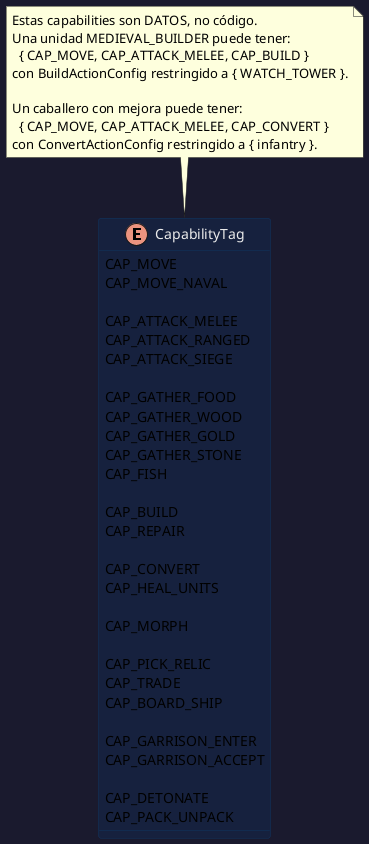
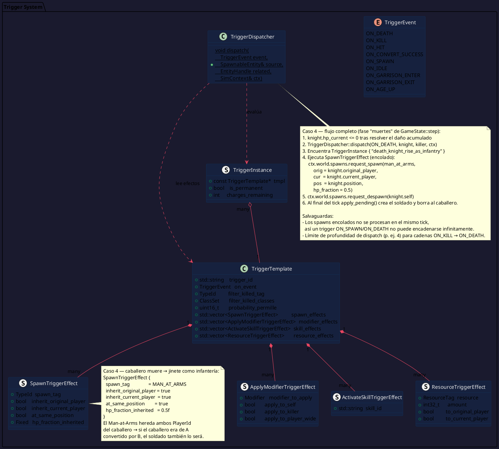
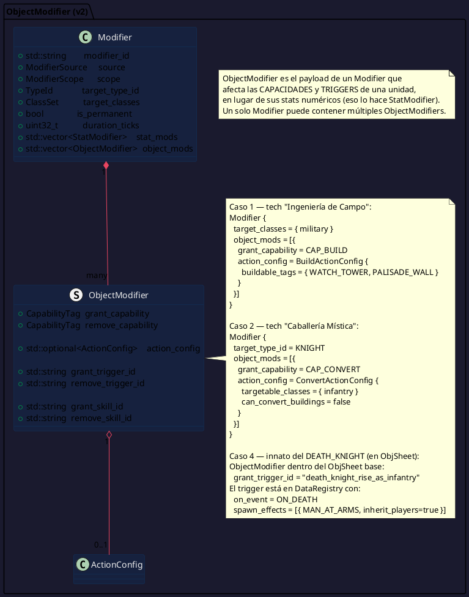
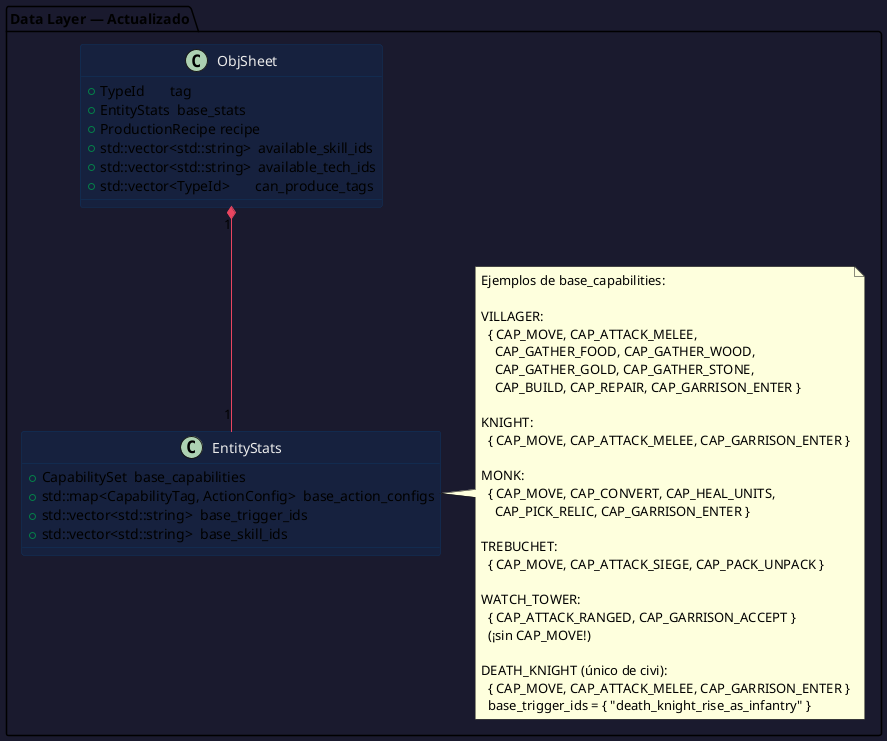
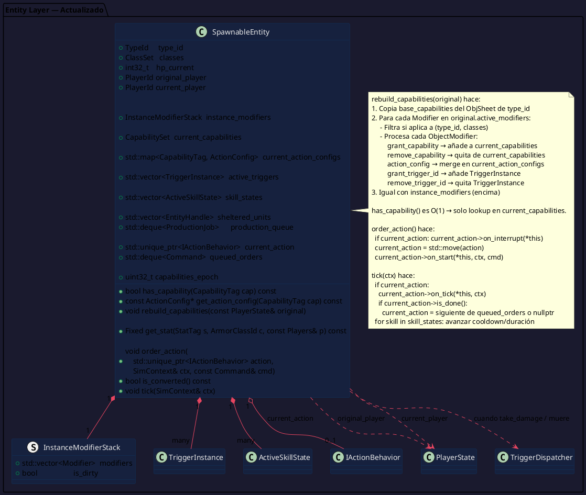
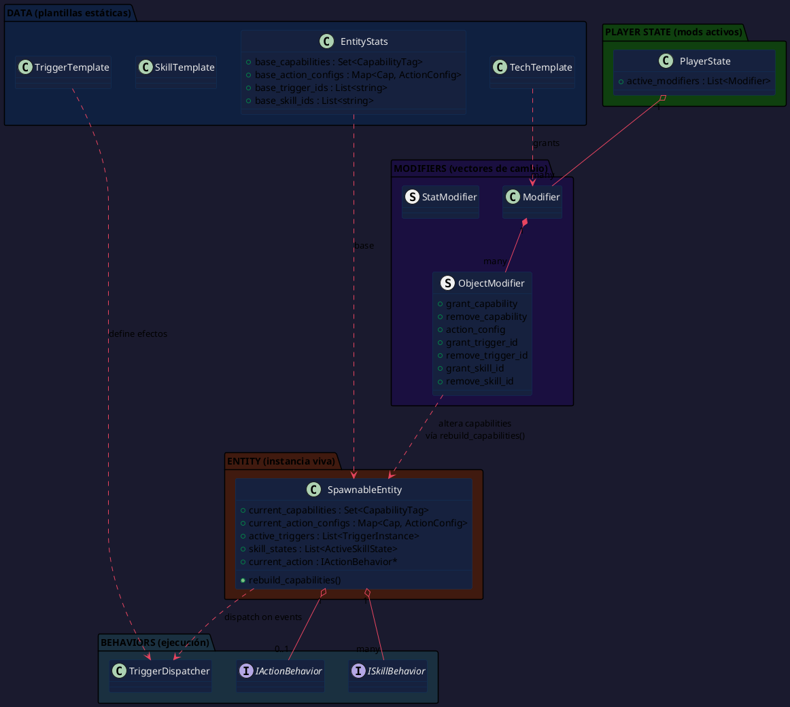

# Sistema de Mutabilidad de Unidades — PlantUML
> Diagrama complementario a `architecture.md`. Solo cubre el sistema de Capabilities + Actions + Triggers.
> La idea central: `ClassSet` (clases definidas en datos) describe lo que una unidad **ES**. `CapabilityTag` describe lo que una unidad **PUEDE HACER**. Son ortogonales y los segundos son totalmente dinámicos.
>
> **v3**: alineado con `architecture.md` v3. Las referencias guardadas son `EntityHandle`, los dueños `PlayerId`, las clases `ClassSet`. `ActionConfig` pasa a ser un `std::variant` (copiable), los behaviors reciben un `SimContext`, los spawns/despawns se encolan para el final del tick y la probabilidad de los triggers usa el `Rng` determinista. `CapabilityTag` **sí** sigue siendo un enum: cada capability tiene código propio en el motor (su `IActionBehavior`).
>
> **Orden de implementación**: este sistema es la fase 6 del [`ROADMAP.md`](ROADMAP.md). Antes hace falta un juego jugable con capabilities fijas; diseñarlo ya está bien, implementarlo primero no.

---

## Los 4 Casos de Uso como Guía de Diseño

| # | Caso | Mecanismo |
|---|---|---|
| 1 | Unidad no-aldeano que construye torres | Modifier otorga `CAP_BUILD` con `BuildActionConfig { WATCH_TOWER }` |
| 2 | Caballeros que convierten infantería enemiga | Tech otorga `CAP_CONVERT` con `ConvertActionConfig { target: INFANTRY }` |
| 3 | Unidad del castillo se sacrifica → edificio | Action `CAP_MORPH` con `MorphActionConfig { consume: true, form: TOWER }` |
| 4 | Caballero muere → jinete se levanta como infantería | Trigger `ON_DEATH` con `SpawnTriggerEffect { spawn: MAN_AT_ARMS }` |

---

## Diagrama 1: CapabilityTag — Lo que una unidad puede hacer

---

## Diagrama 2: ActionConfig — La configuración de cada capability

```plantuml
@startuml ActionConfigs
skinparam backgroundColor #1a1a2e
skinparam classBackgroundColor #16213e
skinparam classBorderColor #0f3460
skinparam classArrowColor #e94560
skinparam classFontColor #eaeaea

package "ActionConfig Hierarchy" {

  class ActionConfig <<std::variant>> {
    using ActionConfig = std::variant<
      BuildActionConfig, ConvertActionConfig,
      MorphActionConfig, HealActionConfig,
      GatherActionConfig, GarrisonAcceptConfig>
    + ActionConfig merge(const ActionConfig& a, const ActionConfig& b)
    ' std::visit: combina dos configs del mismo tipo
    ' (ej: dos BuildActionConfigs unen sus listas)
  }

  note top of ActionConfig
    v2 usaba una jerarquía con unique_ptr<ActionConfig>: eso hacía
    no copiables a EntityStats, ObjectModifier y Modifier, que sí
    se copian (de TechTemplate a PlayerState, de ObjSheet a la entidad).
    Como el conjunto de configs es cerrado (una por capability),
    std::variant da semántica de valor, sin new/delete ni fugas.
    Se almacenan en std::map<CapabilityTag, ActionConfig>.
    Cada alternativa define QUÉ puede hacer la unidad con esa capability.
    Las "flechas de herencia" de abajo representan alternativas del variant.
  end note

  ' ─── Construcción ───────────────────────────────────────
  class BuildActionConfig {
    + std::vector<TypeId> buildable_tags
    ' Qué edificios puede construir esta unidad.
    ' Vacío = puede construir todo lo del jugador.
    ' { WATCH_TOWER } = solo torres de guardia.
    + {static} Self merge(const Self& a, const Self& b)
    ' merge: une los dos buildable_tags (union de conjuntos)
  }

  note right of BuildActionConfig
    Caso 1 — "unidad que construye torres":
    Modifier otorga CAP_BUILD con:
      buildable_tags = { WATCH_TOWER }
    Un aldeano tiene:
      buildable_tags = {} (vacío = todo)
  end note

  ' ─── Conversión ─────────────────────────────────────────
  class ConvertActionConfig {
    + ClassSet               targetable_classes
    ' Qué clases puede convertir (vacío = todas).
    + std::vector<TypeId>    targetable_tags
    ' TypeIds específicos convertibles (vacío = todos de la clase).
    + bool                   can_convert_buildings
    + Fixed                  convert_speed_modifier
    + {static} Self merge(const Self& a, const Self& b)
    ' merge: une targetable_classes y targetable_tags
  }

  note right of ConvertActionConfig
    Caso 2 — "caballeros que convierten infantería":
    Tech otorga CAP_CONVERT con:
      targetable_classes = { infantry }
      can_convert_buildings = false
    Solo infantería militar. No edificios.

    Monje base tiene:
      targetable_classes = {} (vacío = todo)
      can_convert_buildings = true
  end note

  ' ─── Transformación / Morfosis ──────────────────────────
  class MorphActionConfig {
    + TypeId  target_form
    ' En qué se transforma la unidad.
    + bool    consume_original
    ' true  = la unidad original desaparece (sacrificio).
    ' false = la unidad solo cambia de stats (reversible).
    + bool    inherits_hp_percent
    ' Si el nuevo form hereda el % de HP actual.
    + uint32_t cooldown_ticks
    + {static} Self merge(const Self& a, const Self& b)
    ' merge: el último target_form gana (override)
  }

  note right of MorphActionConfig
    Caso 3 — "unidad se sacrifica → edificio":
    Skill activa ejecuta morph:
      target_form      = TOWER
      consume_original = true
      inherits_hp_percent = false
    La unidad desaparece, aparece una torre en su lugar.

    Trebuchet (pack/unpack):
      target_form      = TREBUCHET_PACKED
      consume_original = false  (reversible)
  end note

  ' ─── Curación ───────────────────────────────────────────
  class HealActionConfig {
    + ClassSet               healable_classes
    + Fixed                  heal_range
    + Fixed                  heal_rate_override
    ' 0 = usa HEAL_RATE del stat
    + {static} Self merge(const Self& a, const Self& b)
  }

  ' ─── Recolección ────────────────────────────────────────
  class GatherActionConfig {
    + std::vector<ResourceTag> gatherable_resources
    ' Vacío = todos. Pescador solo tiene FOOD.
    + Fixed gather_rate_override
    ' 0 = usa GATHER_RATE del stat
    + {static} Self merge(const Self& a, const Self& b)
  }

  ' ─── Garrisón (aceptar unidades) ────────────────────────
  class GarrisonAcceptConfig {
    + ClassSet               accepted_classes
    + uint32_t               capacity_override
    ' 0 = usa max_sheltered_units del EntityStats
    + Fixed                  arrow_per_unit
    ' Flechas que dispara el edificio por unidad guarecida
    + {static} Self merge(const Self& a, const Self& b)
  }

  ActionConfig <|-- BuildActionConfig
  ActionConfig <|-- ConvertActionConfig
  ActionConfig <|-- MorphActionConfig
  ActionConfig <|-- HealActionConfig
  ActionConfig <|-- GatherActionConfig
  ActionConfig <|-- GarrisonAcceptConfig
}
@enduml
```

---

## Diagrama 3: IActionBehavior — Strategy para acciones ordenadas

```plantuml
@startuml ActionBehaviors
skinparam backgroundColor #1a1a2e
skinparam classBackgroundColor #16213e
skinparam classBorderColor #0f3460
skinparam classArrowColor #e94560
skinparam classFontColor #eaeaea

package "Action Behavior System (Strategy)" {

  note as Context
    IActionBehavior = acción que el JUGADOR ordena ("build here", "attack that", "convert").
    ISkillBehavior  = habilidad con cooldown que se ACTIVA.
    Son distintas: un monje usa IActionBehavior para convertir (la ordenas)
    pero usa ISkillBehavior si tiene una habilidad especial de área.
  end note

  abstract class IActionBehavior {
    + CapabilityTag required_capability
    + {abstract} bool can_execute(\n    const SpawnableEntity& actor,\n    const SimContext& ctx) const
    + {abstract} void on_start(\n    SpawnableEntity& actor,\n    SimContext& ctx,\n    const Command& cmd)
    + {abstract} void on_tick(\n    SpawnableEntity& actor,\n    SimContext& ctx)
    + {abstract} void on_interrupt(\n    SpawnableEntity& actor)
    + {abstract} bool is_done() const
  }

  class AttackActionBehavior {
    ' Requiere: CAP_ATTACK_MELEE o CAP_ATTACK_RANGED
    - EntityHandle     target
    - uint32_t         reload_ticks_remaining
    + bool can_execute(...) const
    + void on_start(...)
    + void on_tick(...)
    + void on_interrupt(...)
    + bool is_done() const
  }

  class BuildActionBehavior {
    ' Requiere: CAP_BUILD
    ' Respeta BuildActionConfig::buildable_tags
    - TypeId         building_to_place
    - Vec2Fixed      build_target_pos
    - Fixed          build_progress
    - EntityHandle     construction_site
    + bool can_execute(...) const
    ' Verifica que building_to_place esté en BuildActionConfig
    + void on_start(...)
    + void on_tick(...)
    ' Avanza build_progress hasta completion_time del edificio
    + void on_interrupt(...)
    + bool is_done() const
  }

  class ConvertActionBehavior {
    ' Requiere: CAP_CONVERT
    ' Respeta ConvertActionConfig::targetable_classes y targetable_tags
    - EntityHandle     target
    - uint32_t         convert_ticks_elapsed
    - bool             interrupted
    + bool can_execute(...) const
    ' Verifica que el target cumpla ConvertActionConfig
    + void on_start(...)
    + void on_tick(...)
    ' Se interrumpe si el monje/caballero recibe daño
    + void on_interrupt(...)
    + bool is_done() const
  }

  class MorphActionBehavior {
    ' Requiere: CAP_MORPH
    ' Lee MorphActionConfig del actor
    - bool done
    + bool can_execute(...) const
    + void on_start(...)
    ' Ejecuta el morph:
    '   Si consume_original: request_despawn(actor), request_spawn(target_form)
    '   Si no: cambia type_id y classes al nuevo ObjSheet,
    '          ajusta hp según inherits_hp_percent,
    '          rebuild_capabilities() y cancela la acción en curso
    + void on_tick(...)
    + void on_interrupt(...)
    + bool is_done() const
  }

  note right of MorphActionBehavior
    Caso 3 — unidad castillo → torre:
    actor.get_action_config(CAP_MORPH)
      → MorphActionConfig { TOWER, consume_original=true }
    on_start:
      ctx.world.spawns.request_spawn(TOWER,
                     actor.original_player,
                     actor.current_player,
                     actor.position)
      ctx.world.spawns.request_despawn(actor.self)
    (comprobar antes TileMap::can_place para el footprint de la torre)
    La unidad desaparece, aparece la torre.
  end note

  class GatherActionBehavior {
    ' Requiere: CAP_GATHER_*
    - EntityHandle  resource_target
    - Fixed         carry_current
    + bool can_execute(...) const
    + void on_start(...)
    + void on_tick(...)
    + void on_interrupt(...)
    + bool is_done() const
  }

  class HealActionBehavior {
    ' Requiere: CAP_HEAL_UNITS
    - EntityHandle     target
    - uint32_t         heal_ticks_remaining
    + bool can_execute(...) const
    + void on_start(...)
    + void on_tick(...)
    + void on_interrupt(...)
    + bool is_done() const
  }

  class MoveActionBehavior {
    ' Requiere: CAP_MOVE o CAP_MOVE_NAVAL
    - std::vector<sf::Vector2i> path
    - int                       path_index
    + bool can_execute(...) const
    + void on_start(...)
    ' Solicita path al PathfindingGrid
    + void on_tick(...)
    + void on_interrupt(...)
    + bool is_done() const
  }

  class ActionFactory {
    + {static} std::unique_ptr<IActionBehavior> create(\n    CapabilityTag cap)
  }

  IActionBehavior <|-- AttackActionBehavior
  IActionBehavior <|-- BuildActionBehavior
  IActionBehavior <|-- ConvertActionBehavior
  IActionBehavior <|-- MorphActionBehavior
  IActionBehavior <|-- GatherActionBehavior
  IActionBehavior <|-- HealActionBehavior
  IActionBehavior <|-- MoveActionBehavior
  ActionFactory ..> IActionBehavior : crea
}
@enduml
```

---

## Diagrama 4: TriggerSystem — Reacciones pasivas a eventos

---

## Diagrama 5: ObjectModifier actualizado — Otorgar y quitar capabilities y triggers

---

## Diagrama 6: EntityStats y ObjSheet actualizados — Capabilities base

---

## Diagrama 7: SpawnableEntity actualizado — Capabilities dinámicas

---

## Diagrama 8: Los 4 casos de uso en acción

```plantuml
@startuml UseCases
skinparam backgroundColor #1a1a2e
skinparam classBackgroundColor #16213e
skinparam classBorderColor #0f3460
skinparam classArrowColor #e94560
skinparam classFontColor #eaeaea
skinparam noteBackgroundColor #0f3460

package "Caso 1 — Unidad que construye torres (no aldeano)" #0f2040 {
  note as C1
    **Tech: "Ingeniería de Campo"**
    Researched at: BARRACKS (feudal age)
    grants Modifier {
      target_classes = { military }
      object_mods = [ObjectModifier {
        grant_capability  = CAP_BUILD
        action_config     = BuildActionConfig {
                              buildable_tags = { WATCH_TOWER }
                            }
      }]
    }

    Resultado:
    ► Toda unidad militar del jugador:
        current_capabilities.contains(CAP_BUILD) == true
        get_action_config(CAP_BUILD)
          → BuildActionConfig { buildable_tags = {WATCH_TOWER} }

    ► Jugador selecciona infantería → icono "Construir"
        Si el jugador tiene un aldeano Y un guerrero seleccionados
        y ordena construir una torre:
          - aldeano: usa BuildActionBehavior,
                     can_execute() → buildable_tags vacío = todo ✓
          - guerrero: usa BuildActionBehavior,
                      can_execute() → WATCH_TOWER en su config ✓
          - guerrero no puede construir BARRACKS:
                      can_execute() → BARRACKS no en buildable_tags ✗
  end note
}

package "Caso 2 — Caballeros que convierten infantería" #1a0f40 {
  note as C2
    **Tech: "Caballería Mística"** (unique tech del Castillo)
    grants Modifier {
      target_type_id = KNIGHT  (solo caballeros)
      object_mods = [ObjectModifier {
        grant_capability  = CAP_CONVERT
        action_config     = ConvertActionConfig {
                              targetable_classes = { infantry }
                              can_convert_buildings = false
                              convert_speed_modifier = 0.5f
                            }
      }]
    }

    Resultado:
    ► Solo los KNIGHT del jugador:
        current_capabilities.contains(CAP_CONVERT) == true
        get_action_config(CAP_CONVERT)
          → ConvertActionConfig { infantry, no buildings, 0.5x speed }

    ► MONK del mismo jugador sigue con su ConvertActionConfig base:
        targetable_classes = {} (vacío = todo)
        can_convert_buildings = true
        (los modifiers solo aplican a KNIGHT por target_type_id)

    ► Knight intenta convertir un TREBUCHET (siege weapon):
        ConvertActionBehavior::can_execute():
          target.classes == { siege, military }
          ninguna está en targetable_classes = { infantry } → ✗ cancelado
  end note
}

package "Caso 3 — Unidad se sacrifica → edificio" #401a0f {
  note as C3
    **ObjSheet: RITUAL_WARRIOR** (unique unit del Castillo)
    EntityStats::base_capabilities = {
      CAP_MOVE, CAP_ATTACK_MELEE, CAP_MORPH
    }
    base_action_configs[CAP_MORPH] = MorphActionConfig {
      target_form      = RITUAL_TOWER
      consume_original = true
      inherits_hp_percent = false
    }

    También tiene skill activa "Ritual del Sacrificio":
    → Cuando el jugador la activa, ejecuta:
    SkillBehavior (MorphSkillBehavior):
      1. Verifica actor.has_capability(CAP_MORPH) → true
      2. Lee actor.get_action_config(CAP_MORPH)
             → MorphActionConfig { RITUAL_TOWER, consume=true }
      3. Verifica TileMap::can_place(RITUAL_TOWER, tile de actor.position)
      4. ctx.world.spawns.request_spawn(RITUAL_TOWER,
                         actor.original_player,
                         actor.current_player, actor.position)
      5. ctx.world.spawns.request_despawn(actor.self)

    ► Un guerrero normal NO tiene CAP_MORPH (ni base ni otorgada
      por ninguna tech), así que la skill no aplica a él.
      (Ojo: "Ingeniería de Campo" del Caso 1 otorga CAP_BUILD, no CAP_MORPH.)
    ► Solo el RITUAL_WARRIOR tiene esta capability en su base.
  end note
}

package "Caso 4 — Caballero muere → jinete se levanta" #0f400f {
  note as C4
    **ObjSheet: DEATH_KNIGHT** (unique unit)
    EntityStats::base_capabilities = {
      CAP_MOVE, CAP_ATTACK_MELEE, CAP_GARRISON_ENTER
    }
    base_trigger_ids = { "death_knight_rise_as_infantry" }

    **TriggerTemplate en DataRegistry:**
    TriggerTemplate {
      trigger_id    = "death_knight_rise_as_infantry"
      on_event      = ON_DEATH
      probability_permille = 1000
      spawn_effects = [SpawnTriggerEffect {
        spawn_tag               = MAN_AT_ARMS
        inherit_original_player = true
        inherit_current_player  = true
        at_same_position        = true
        hp_fraction_inherited   = 0.5f
      }]
    }

    **Flujo en GameState::step() (fase "muertes"):**
    1. dk.hp_current <= 0 tras resolver el daño acumulado
    2. TriggerDispatcher::dispatch(ON_DEATH, dk, killer, ctx)
    3. Itera dk.active_triggers:
         TriggerInstance { "death_knight_rise_as_infantry", charges=-1 }
         on_event == ON_DEATH → tira ctx.rng contra probability_permille → dispara
    4. Ejecuta SpawnTriggerEffect (encolado):
         ctx.world.spawns.request_spawn(man_at_arms,
             orig = dk.original_player, cur = dk.current_player,
             pos = dk.position, hp_fraction = 0.5)
    5. ctx.world.spawns.request_despawn(dk.self)
    6. apply_pending() al final del tick: crea el soldado
       (que ejecuta rebuild_capabilities en su primer tick) y borra al dk.

    ► Si el Death Knight había sido convertido:
         original_player = A, current_player = B
         → El nuevo Man-at-Arms también es "de A, controlado por B"
         → Sus stats salen de A, su allegiance es de B
  end note
}
@enduml
```

---

## Diagrama 9: Vista completa del sistema de mutabilidad

